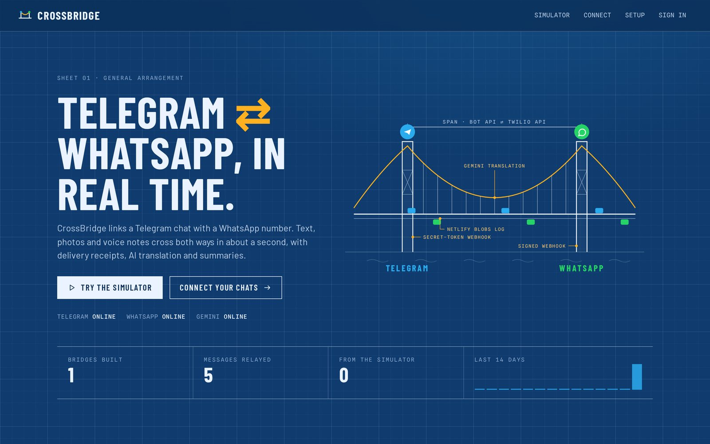
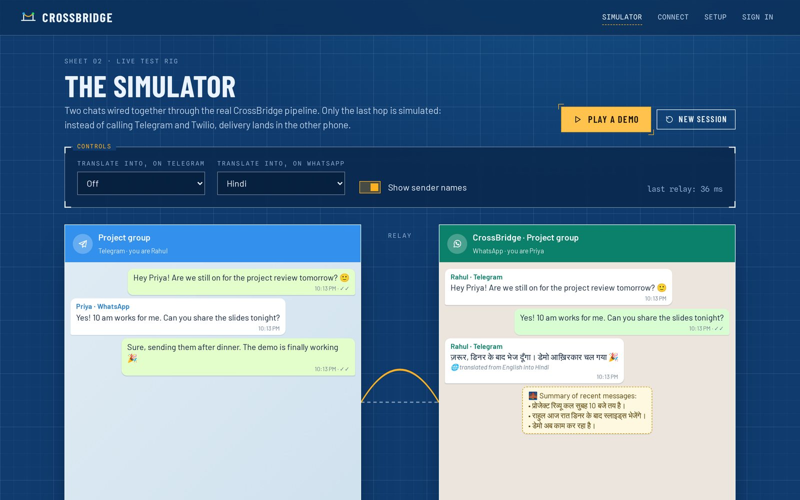
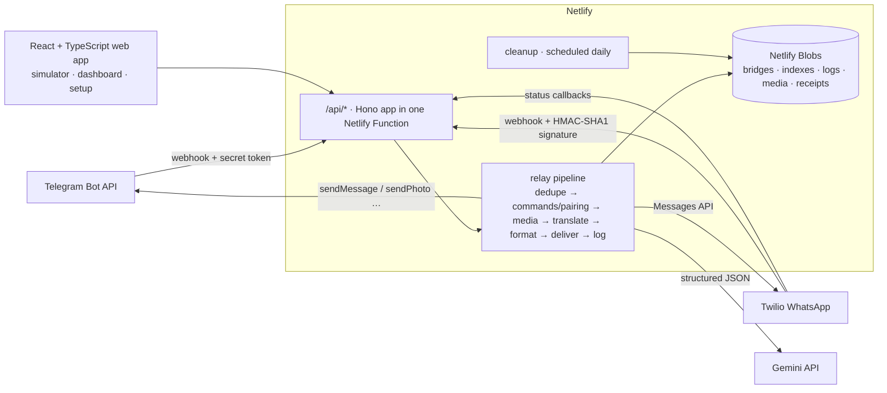

# CrossBridge

**Telegram ⇄ WhatsApp, in real time.** CrossBridge links a Telegram chat (private or group) with a WhatsApp number. Text, photos, voice notes, videos and documents cross both ways in about a second, with delivery receipts, optional AI translation and on-demand summaries. A web dashboard shows every message's path through the pipeline, and a live simulator lets anyone try it without a phone.

**Live:** https://crossbridge-nishant.netlify.app &nbsp;·&nbsp; **Author:** [Nishant Singh](https://nishant-singhaa0240274.netlify.app)



## Features

**Bridging**
- **Pair in a minute with a code.** Send `/start` to the bot on Telegram (or add it to a group), get a code like `CB-7K2PQ`, and send that code on WhatsApp. It works the other way round too: send `link` on WhatsApp and `/link CB-XXXXX` on Telegram.
- **Both directions, all common media.** Text, photos, voice notes, videos and documents up to 5 MB. Media is copied to Netlify Blobs and served from a short-lived URL that Telegram and Twilio fetch.
- **Sender names** (on or off), "edited" markers for edited Telegram messages, and HTML escaping so nothing a user types can break the formatting.
- **Chat commands** on both sides: `/status`, `/summary`, `/translate hi` (or `off`), `/pause`, `/resume`, `/unlink`, `/help`, and `/login` on Telegram.

**Reliability**
- **Delivery receipts.** Twilio status callbacks move each message through queued → sent → delivered → read, and never backwards.
- **Failures explained in plain words.** When WhatsApp's 24-hour reply window has closed, or a number never joined the sandbox, the sender is told on Telegram instead of the message silently disappearing.
- **Exactly-once processing.** Telegram `update_id`s and Twilio `MessageSid`s are claimed with atomic `onlyIfNew` writes, so webhook retries never send duplicates. If processing fails, the claim is released so the platform can retry.
- **Rate limits** per bridge (300 messages a day), per IP and per command, and a single "forwarding is paused" notice instead of one per message.

**AI (Gemini, optional)**
- **Translation per direction:** for example, everything arriving on WhatsApp in Hindi and everything arriving on Telegram in English. Gemini returns structured JSON and skips messages already in the target language.
- **`/summary`:** decisions, open questions and to-dos from the last 40 messages, in the reader's language.
- Everything works without a Gemini key; AI features simply switch off.

**Web app**
- **Simulator:** two phones wired through the real pipeline. Only the last hop is simulated. Each message shows a timed **pipeline trace** (received → media → translated → formatted → handed over).
- **Dashboard** with no passwords: `/login` in a private Telegram chat returns a one-time sign-in link (10 minutes). It lists your bridges, a live message log with receipts and traces, and settings such as name, translation, sender names, pause and unlink. WhatsApp numbers are masked.
- **Connect** page with QR codes for the bot and a pre-filled WhatsApp message, and a **Setup** checklist that checks the deployment's configuration and registers the Telegram webhook.




## Architecture



- **One pipeline for everything.** `netlify/lib/relay.ts` handles every inbound message the same way, whichever side it came from. The simulator runs the same code; only `deliver()` writes to the log instead of calling Telegram or Twilio.
- **Webhook security.** Telegram requests must carry the `X-Telegram-Bot-Api-Secret-Token` set during registration (derived from the bot token with HMAC, compared in constant time). Twilio requests are verified with `X-Twilio-Signature` (HMAC-SHA1 over the URL and sorted parameters).
- **Storage (Netlify Blobs).** Bridges live at `b/<id>` with indexes `idx/tg/<chatId>` and `idx/wa/<number>`, pairing codes at `code/<CODE>` (30 minutes), logs at `log/<id>` (last 300 entries), `pid/<sid>` maps a Twilio message to its log entry for receipts, and `owner/<telegramUserId>` powers the dashboard. Writes that can race use ETag-conditional updates with retries.
- **Auth.** The dashboard uses HS256 JWTs signed with Web Crypto. Sign-in links are single-use tokens delivered by the bot, so no passwords are stored.
- **Housekeeping.** A scheduled function deletes simulator sessions after a day, media after a week, and expired dedupe keys, rate-limit windows and sign-in links.

### API

| Method | Path | What it does |
|---|---|---|
| POST | `/api/webhooks/telegram` | Telegram updates (secret header required) |
| POST | `/api/webhooks/twilio` | Incoming WhatsApp messages (signature required) |
| POST | `/api/webhooks/twilio/status` | Delivery receipts |
| GET | `/api/media/:id` | Relayed media (safe content types only, `nosniff`) |
| GET | `/api/health` | Configuration status and webhook URLs |
| GET | `/api/stats` | Bridges, messages and 14-day activity |
| POST | `/api/setup/telegram` | Registers the webhook and command menu (needs the bot token) |
| POST | `/api/auth/exchange` | One-time sign-in link → session |
| GET | `/api/me` | Your bridges |
| GET · PATCH · DELETE | `/api/bridges/:id` | Log and settings; unlink |
| POST · GET · PATCH | `/api/sim`, `/api/sim/:id` | Simulator sessions |
| POST | `/api/sim/:id/send` | Send a message through the pipeline |

## Tech stack

TypeScript (strict) everywhere · React 18 + Vite · Framer Motion · React Router · Hono on Netlify Functions · Zod validation · Netlify Blobs · Telegram Bot API · Twilio Programmable Messaging (WhatsApp) · Gemini API · Web Crypto (HMAC, SHA-256, JWT).

Design: a blueprint drawing sheet in Prussian blue with white linework and amber annotations; Barlow Condensed, Barlow and Spline Sans Mono.

## Run it yourself

You need a Telegram bot, a Twilio account with the WhatsApp sandbox, and (optionally) a Gemini API key.

1. **Telegram bot:** message [@BotFather](https://t.me/BotFather), send `/newbot`, and copy the token. For groups, also send `/setprivacy` → your bot → **Disable**, so the bot sees every message.
2. **Twilio WhatsApp sandbox:** in the Twilio Console open **Messaging → Try it out → Send a WhatsApp message**. Note the sandbox number (for example `+14155238886`) and your join phrase (`join something-something`). Copy the **Account SID** and **Auth Token** from the console home page.
3. **Netlify:** import the repo, then add these environment variables **before the first deploy** (mark tokens as secret):

   | Variable | Required | Example |
   |---|---|---|
   | `TELEGRAM_BOT_TOKEN` | yes | `123456789:AA…` |
   | `TWILIO_ACCOUNT_SID` | yes | `AC…` |
   | `TWILIO_AUTH_TOKEN` | yes | from the Twilio console |
   | `TWILIO_WHATSAPP_NUMBER` | yes | `+14155238886` |
   | `TWILIO_SANDBOX_KEYWORD` | for the sandbox | `something-something` (the words after "join") |
   | `GEMINI_API_KEY` | no | enables translation and summaries |
   | `GEMINI_MODEL` | no | overrides the default model |
   | `JWT_SECRET` | no | 32+ random characters; one is generated and stored if omitted |

4. **Webhooks:** open `/setup` on your site. Paste the bot token to register the Telegram webhook. Then, in Twilio's sandbox settings, set **When a message comes in** to `https://<your-site>/api/webhooks/twilio` (POST). The setup page shows both URLs and ticks off each part of the configuration. Delivery receipts need no setup: every outgoing WhatsApp message carries its own status-callback URL.
5. On WhatsApp, send the join phrase to the sandbox number, then follow the **Connect** page.

WhatsApp only lets a business number reply within 24 hours of the person's last message, and the sandbox only reaches numbers that have joined it. CrossBridge tells you on Telegram when either rule blocks a message.

### Local development

```bash
npm install
cp tests/e2e.env .env          # points the app at local mock services
python3 tests/mock_services.py # mock Telegram, Twilio and Gemini on :9998
npx netlify dev                # http://localhost:8888
```

## Tests

- `npm test`: unit tests for Twilio signatures (including Twilio's documented example), update parsing, number normalisation, JWTs and pairing codes.
- `npm run typecheck`: strict TypeScript across the app, functions and tests.
- `python3 tests/e2e_test.py`: 43 end-to-end checks against the mock services, covering webhook security, pairing, relaying both ways, media, retries, translation, summaries, pause, delivery receipts, 24-hour-window failures, the dashboard and the simulator.

The screenshots come from a local run against these mock services.

## License

MIT © 2026 Nishant Singh
